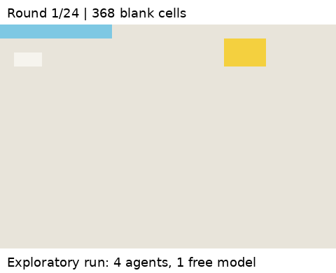

# Swarm Canvas

In one exploratory run, an agent claimed "Canvas complete" with 209 cells still blank at the end of that round. Another later cited that claim and stopped painting. [Inspect the public evidence](docs/evidence/retained-notes-seed11/README.md).

A research harness for observing how language-model agents communicate and paint a shared scene. Our goal is autonomous coordination from a plain-text description, followed by experiments with swarm size, model mix, canvas size, and optional assistance.

**Native SwarmChat is required for our swarm experiments. Development inference uses OpenRouter free models exclusively.**

The current canvas is **24 × 16**. Agents see a shared start-of-round snapshot and submit actions simultaneously. Actions resolve in a seeded shuffled order; later paint wins. Agents have permanent slot IDs, display names, and scratchpads. Reference images are represented as text grids of color codes, not vision inputs.

## Where we are

The harness supports bounded live runs, request accounting, local traces, optional interface feedback, reference-visibility probes, and narrow recovery at verified completed-round boundaries. It has not demonstrated reliable autonomous scene completion. All results below are exploratory.

| Experiment | Observation |
| --- | --- |
| Three open-ended six-round runs | Agents exchanged plans, but 419 of 562 applied paints repeated the existing color. |
| Color legend + previous-action feedback | Repetition was 308 of 530 paints across three later runs. Over-budget proposals increased. |
| One-time preview vs leader-only reference | Preview group painted 95 cells; leader group painted 27. Painter count and reference access differed. |
| 24 vs 48 rounds after preview | The longer run eventually painted the entire canvas light blue. Its higher pixel agreement reflected background color, not a successful boat. |
| Retained preview notes, 24 rounds | A partial boat survived, but agents declared completion and stopped with much of the canvas blank. |
| Optional look costing a turn, 24 rounds | No agent selected a look. All eventually estimated zero more rounds, despite an incomplete reference. |
| Optional free look, six rounds | One agent looked in round one and then painted that round. This short run is not directly comparable to 24 rounds. |

See [findings and limitations](docs/findings.md) for measurements, failure records, and evidence. Pixel agreement alone can reward a dominant background color.

## Quick start

    python -m pip install -r requirements.txt
    python -m pytest -q
    python cli.py run configs/c1_nochat.yaml --seed 1
    python cli.py swarmchat-check

The random-agent run makes no model calls. The transport check uses the actual local SwarmChat server with scripted agents.

For a capped live boat check, set OPENROUTER_API_KEY in the process environment:

    python -m swarm_canvas.open_boat_check --seeds 11 --rounds 4

Preflight checks the pinned model, zero pricing, and free-request quota. The shared ledger counts repairs, retries, and schema fallbacks. The model seam rejects paid IDs and other providers, sets zero price ceilings, and disables provider fallback. Free-model availability can change.

Historical C0/C1/C2a/C2b configurations compare one painter, multiple painters without messages, a document log, and SwarmChat. Their reconstruction tasks show a reference each turn; they differ from the open-ended boat task. Shipped configs include random and live agents: inspect agents.type before running.

## Experimental switches

Independent assistance switches: reference_image, assigned_territories, suggested_paints, require_messages, and require_peer_acks. Interface switches: color_legend and action_results. Open-ended defaults keep them off. Repeated paints are allowed.

These exploratory modules make live calls and require sufficient free quota:

    python -m experiments.reference_visibility_probe
    python -m experiments.duration_probe
    python -m experiments.retained_notes_probe
    python -m experiments.voluntary_peek_probe
    python -m experiments.free_peek_probe

The free-look module now specifies 24 rounds for the pending comparison. The earlier six-round script is preserved in its evidence archive.

The three-seed matched look comparison is prepared, not completed:

    python -m experiments.matched_peek_comparison
    python -m experiments.matched_peek_comparison --resume runs/<comparison>.json

The interleaved schedule checks quota before each condition and retains completed and failed attempts. It is not a background scheduler. Interrupted active attempts require inspection. Free looks preserve the painting turn but use another model call.

## Traces, accounting, and recovery

Run directories retain manifests, canvas frames, events.jsonl, rendered prompts, and traces.jsonl. Probes also retain preview traces and optional estimates/look choices. Missing estimates and malformed actions remain part of the record.

SWARM_CANVAS_TRACING=local keeps tracing local. The default auto mode uses the Langfuse SDK with complete credentials, otherwise OpenRouter Broadcast context plus local spans. Destination delivery must be verified separately; these probes do not establish Langfuse ingestion. See [tracing setup](docs/harness-guide.md#tracing-and-langfuse).

The durable SQLite ledger reserves attempts before transport; unknown outcomes remain consumed:

    python -m swarm_canvas.request_budget runs/<batch>/budget.sqlite3

Recovery supports only verified completed-round boundaries with the original config, source, Python version, native local channel, and event log. LLM recovery also requires the original ledger identity and checkpoint attempt count. Partial rounds, later requests, remote channels, and custom probe agents are unsupported. See [recovery scope](docs/roadmap/open-boat.md).

Never commit credentials. Exclude native swarmchat databases and recovery tokens from shared archives. Traces can contain prompts and messages; credential masking is not a general privacy guarantee.

## Next steps

1. Complete the matched look-cost comparison across seeds, reporting every attempt.
2. Evaluate recognizable output separately from background-dominated pixel agreement, and check completion claims against actual state.
3. Test swarm sizes and mixed models with documented paint and compute budgets.
4. Expand canvas size after those comparisons run reliably. The current runner validates a 24 × 16 grid.
5. Run the opt-in study redesign (prefilled background, split reference, done action, non-background scoring, fixed-allowance swarm-size sweep). See [study redesign](docs/roadmap/study-redesign.md); its configs are `configs/redesign_*.yaml` and run offline with random agents.

Reference access, retained notes, leaders, and other assistance are explicit interventions that can be turned off. The main goal remains observing a swarm act from a plain-text goal.

The [harness guide](docs/harness-guide.md) preserves detailed CLI commands, condition definitions, remote SwarmChat setup, tracing configuration, and historical pilot instructions.

See the [accelerated research roadmap](docs/research-roadmap.md) for the shortest path from this example to a preregistered replication.
