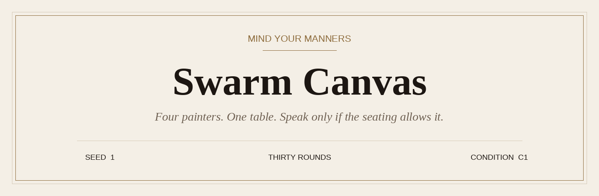
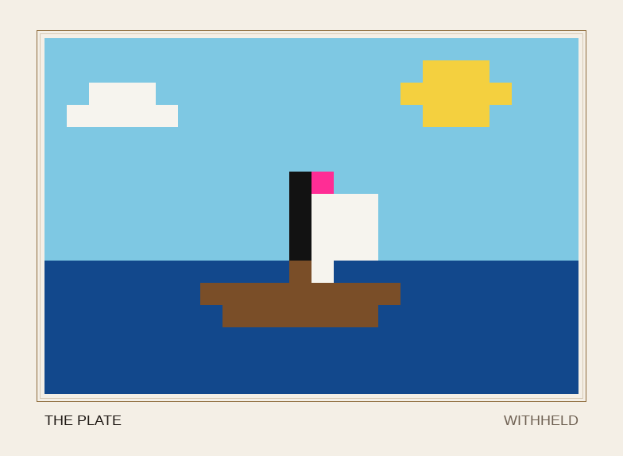

<p align="center">
  
</p>

<p align="center">
  
</p>

<p align="center">
  <em>Seed 1 · condition C1 · the channel is closed · no model was called</em>
</p>

The film is the dry run of `configs/c1_nochat.yaml`. Shipped configs use `agents.type: random`, so a sitting makes no model calls. Same seed, same canvas. Run it again and `runs/c1_s1/timelapse.gif` is this film, unframed.

## The company

Four painters share a 24×16 grid for 30 rounds. The harness changes only what they are allowed to say to each other.

## Mind your manners

| At the table | |
| --- | --- |
| An invalid action is logged and dropped. | The round continues without it. |
| A reply that is not JSON gets one repair prompt. | If it is still not JSON, that painter passes the round. |
| The scoring plate is read only by `swarm_canvas/score.py`. | No painter is shown the plate. |
| Catalog colors arrive one round late. | They arrive only for the painter who asked. |

<p align="center">
  
</p>

<p align="center">
  <em>The plate. Withheld.</em>
</p>

## The seating

| Condition | Channel | Config |
| --- | --- | --- |
| C0 | none, solo prompt | `configs/c0_baseline.yaml` |
| C1 | none, shared grid | `configs/c1_nochat.yaml` |
| C2a | numbered doc log | `configs/c2a_doc.yaml` |
| C2b | SwarmChat `#canvas` | `configs/c2b_swarmchat.yaml` |

## Be seated

```bash
python cli.py run configs/c1_nochat.yaml --seed 1
python cli.py score runs/c1_s1
python cli.py judge runs/c1_s1
pytest
```

Dependencies: `openpyxl`, `pillow`, `imageio`, `pyyaml`, `httpx`, `pytest`.

## If you invite a model

Flip `agents.type` to `llm`. Every model call goes through `swarm_canvas/models.py` `call_model()` (`anthropic`, `openrouter`, or `openai_compatible`). Keys stay in the environment (`ANTHROPIC_API_KEY`, `OPENROUTER_API_KEY`, `OPENAI_API_KEY`). Prompts live in `prompts/`.

C2b mirrors notes to `comms.server_url` when it is set, using `configs/swarmchat_tokens.example.yaml`. With an empty URL the local channel log still enforces the cap.
