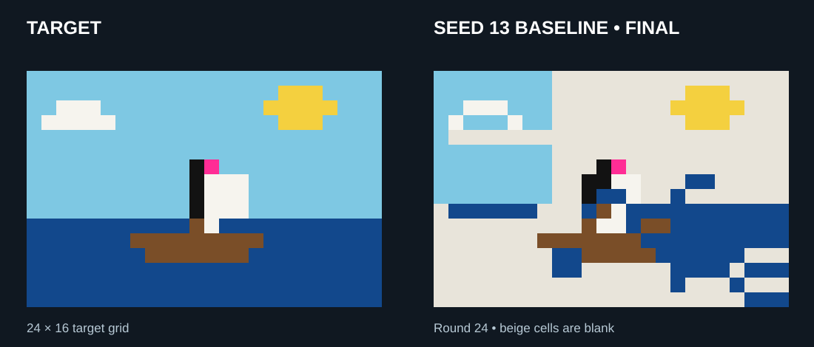

# Swarm Canvas

**“All 384 cells complete,”** one agent announced. Its view of the shared canvas still had **220 blank cells**.

Swarm Canvas is a research harness for studying how language-model agents coordinate through **SwarmChat** while painting a shared pixel grid. The claim below comes from one exploratory run.

<picture>
  <source media="(prefers-color-scheme: dark)" srcset="assets/banner-dark.svg">
  
</picture>

## The task and the result

Four agents worked for 24 rounds to reconstruct a 24 × 16 image. Each saw the reference once and could keep notes. Below, the target is next to the final canvas from the same seed-13 baseline run shown above.

The final canvas had **217 blank cells**. Across six completed runs, the agents correctly matched 13 to 41 of the target's 51 non-sky, non-water cells. Across those runs, 2,734 of 4,558 applied paints (60.0%) repeated the color already present at the time of application; repeats include actions within the same round and may be intentional.

### What these results can and cannot tell us

These are six exploratory assisted reconstruction runs, using `deepseek/deepseek-v4.1-flash-1017` across seeds 11–13. They do not establish performance on unassisted plain-text tasks or a general completion-failure rate. Three runs had a reminder enabled, but it never fired, so the comparison cannot establish a reminder effect. One earlier seed-13 attempt was interrupted and replaced; its record is retained. The proposed 39-run study was not run.

The replays use saved end-of-round canvases. The round-12 claim is paired with the end-of-round-11 snapshot the agent received.

[Results, methods, and evidence](docs/evidence/paired-study/README.md) · [Earlier findings](docs/findings.md) · [Research roadmap](docs/research-roadmap.md)

## How the harness works

Agents see a shared start-of-round snapshot and submit actions simultaneously. Actions resolve in a seeded shuffled order; later paint wins. Agents have permanent slot IDs, display names, and scratchpads. Reference images are text grids of color codes, not vision inputs. Assistance such as previews, territories, and feedback can be switched on or off.

The harness has not demonstrated reliable autonomous completion. Background-heavy pixel agreement can overstate success; the results also report matches on the target’s non-background cells. Native SwarmChat is required for swarm experiments. Development defaults to free OpenRouter models; the six-run study used the paid model named above.

## Quick start

    python -m pip install -r requirements.txt
    python -m pytest -q
    python cli.py run configs/c1_nochat.yaml --seed 1
    python cli.py swarmchat-check

The random-agent run makes no model calls. The transport check uses the actual local SwarmChat server with scripted agents.

For a capped live boat check, set OPENROUTER_API_KEY in the process environment:

    python -m swarm_canvas.open_boat_check --seeds 11 --rounds 4

Preflight checks the pinned model, zero pricing, and free-request quota. The shared ledger counts repairs, retries, and schema fallbacks. The model seam rejects paid IDs and other providers, sets zero price ceilings, and disables provider fallback. Free-model availability can change.

Historical C0/C1/C2a/C2b configurations compare one painter, multiple painters without messages, a document log, and SwarmChat. Their reconstruction tasks show a reference each turn; they differ from the open-ended boat task. Shipped configs include random and live agents: inspect agents.type before running.

## Experimental switches

Independent assistance switches: reference_image, assigned_territories, suggested_paints, require_messages, and require_peer_acks. Interface switches: color_legend and action_results. Open-ended defaults keep them off. Repeated paints are allowed.

These exploratory modules make live calls and require sufficient free quota:

    python -m experiments.reference_visibility_probe
    python -m experiments.duration_probe
    python -m experiments.retained_notes_probe
    python -m experiments.voluntary_peek_probe
    python -m experiments.free_peek_probe

The free-look module now specifies 24 rounds for the pending comparison. The earlier six-round script is preserved in its evidence archive.

The three-seed matched look comparison is prepared, not completed:

    python -m experiments.matched_peek_comparison
    python -m experiments.matched_peek_comparison --resume runs/<comparison>.json

The interleaved schedule checks quota before each condition and retains completed and failed attempts. It is not a background scheduler. Interrupted active attempts require inspection. Free looks preserve the painting turn but use another model call.

## Traces, accounting, and recovery

Run directories retain manifests, canvas frames, events.jsonl, rendered prompts, and traces.jsonl. Probes also retain preview traces and optional estimates/look choices. Missing estimates and malformed actions remain part of the record.

SWARM_CANVAS_TRACING=local keeps tracing local. The default auto mode uses the Langfuse SDK with complete credentials, otherwise OpenRouter Broadcast context plus local spans. Destination delivery must be verified separately; these probes do not establish Langfuse ingestion. See [tracing setup](docs/harness-guide.md#tracing-and-langfuse).

The durable SQLite ledger reserves attempts before transport; unknown outcomes remain consumed:

    python -m swarm_canvas.request_budget runs/<batch>/budget.sqlite3

Recovery supports only verified completed-round boundaries with the original config, source, Python version, native local channel, and event log. LLM recovery also requires the original ledger identity and checkpoint attempt count. Partial rounds, later requests, remote channels, and custom probe agents are unsupported. See [recovery scope](docs/roadmap/open-boat.md).

Never commit credentials. Exclude native swarmchat databases and recovery tokens from shared archives. Traces can contain prompts and messages; credential masking is not a general privacy guarantee.

## Next steps

The immediate priority is to publish the exploratory results with their limits and close out this study. Future work can improve completion detection, evaluate scene quality beyond background pixels, test less assistance, and scale the swarm and canvas with controlled budgets.

The [harness guide](docs/harness-guide.md) has detailed commands, condition definitions, tracing configuration, and historical pilot instructions. The [research roadmap](docs/research-roadmap.md) describes follow-on work.
