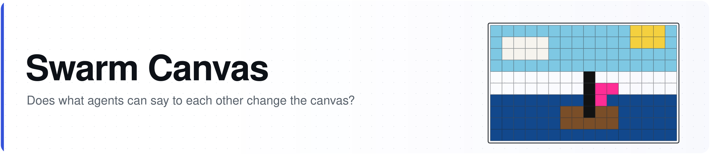
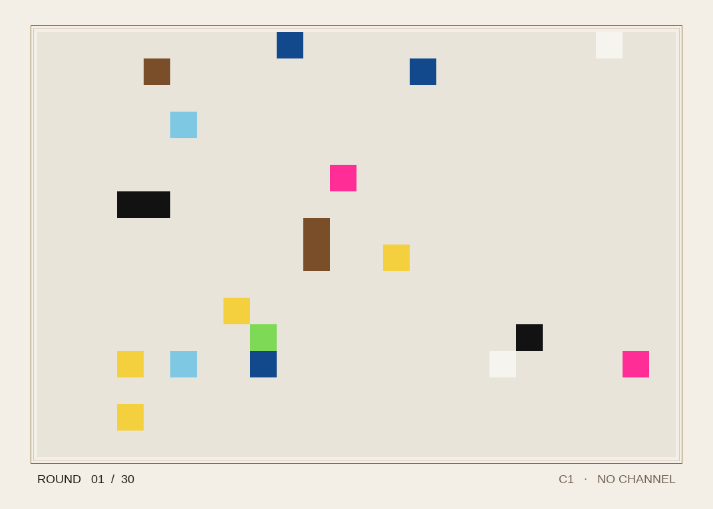

<p align="center">
  <picture>
    <source media="(prefers-color-scheme: dark)" srcset="assets/banner-dark.svg">
    
  </picture>
</p>

# Swarm Canvas


A small environment for testing how communication changes agents' ability to produce a shared artifact. Painters act on the same 24×16 canvas in simultaneous rounds. Their validated actions are applied in seeded, shuffled order; later writes win.

**SwarmChat is a required experimental condition. Development model calls are restricted in code to OpenRouter free models.** The shipped configurations use random agents and make no model calls.

## Conditions and objective

| Condition | Painters | Paint allowance per painter per round | Channel |
| --- | --- | --- | --- |
| C0 | 1 | 32 | None |
| C1 | 4 | 8 | None |
| C2a | 4 | 8 | Shared numbered document log |
| C2b | 4 | 8 | SwarmChat adapter |

Every condition has the same maximum of 32 paint actions per round. Compute is **not** matched: the group makes more calls and processes more context. Record tokens and reported cost separately.

The four condition configs use **target reconstruction**. Every painter sees the target color grid each turn. The primary outcome is the fraction of cells matching that target. `configs/free_creation.yaml` preserves open-ended creation; it has no hidden target score and requires separate blind quality evaluation before research use.

Three targets are included: `sun_boat`, `stripes`, and `checker`. They use only base-palette colors. The delayed, private supplier remains available, but these tasks do not require catalog colors. They therefore do not test the value of resource negotiation.

## Run locally without model calls

```bash
pip install -r requirements.txt
python -m pytest -q
python cli.py run configs/c1_nochat.yaml --seed 1
```

The command prints the actual run directory, such as `runs/c1_s1_<attempt-id>`. Use that directory for `score`, `judge`, and `export`:

```bash
python cli.py score runs/<printed-run-directory>
python cli.py judge runs/<printed-run-directory>
python cli.py export runs/<printed-run-directory> replay.json
```

Each attempt gets a new directory. A manifest records its completion state, exact final frame and canvas hash, saved target and target hash, effective model settings, immutable slot IDs, prompt hashes, supplier settings, and token totals. Failed attempts remain marked failed and cannot be scored. Names are display labels; simultaneous duplicate renames are rejected.

The event log separates API failures, malformed JSON, invalid actions, and deliberate passes. JSON gets one repair attempt; API errors do not trigger JSON repair. Read acknowledgments are accepted only for lines shown to that agent. The document log records exposure alone; C2b records native server read confirmations separately.

Metrics include coverage, target accuracy, per-round accuracy, correct cells destroyed, redundant paints, the first round reaching 90% accuracy with cumulative paints/tokens, and reliability counts. Token/cost data include repair calls. Missing provider cost metadata is unknown, not assumed free based on a successful response. Random smoke tests are not collaboration evidence.

## OpenRouter free-only development policy

To use a live model, copy a config, set `agents.type: llm`, and set `model.name` to a currently available, explicit OpenRouter model ID ending in `:free`. Supply `OPENROUTER_API_KEY` through the environment. Use the same model and settings for all conditions.

The shared model-call layer blocks paid model IDs and other providers before sending HTTP requests, including judge requests. Every OpenRouter request includes zero prompt/completion/request price ceilings and disables provider fallback. There is no paid-model override in this development version. Supporting paid runs requires a separate, explicitly authorized code change.

`openrouter/free` is allowed for standalone smoke checks, but it selects models dynamically, so the pilot runner rejects it. Actual served model/provider IDs, response IDs, reported usage/cost, and call timing are recorded. Free-model availability and limits may interrupt a run; failed calls are flagged rather than interpreted as agent inactivity. No automatic fallback to a paid model occurs.

For models with optional reasoning, `model.reasoning_enabled: false` explicitly disables it. Do not combine that with a reasoning token budget. Call records include finish reason, reported reasoning tokens, and whether visible content was returned, so token-limit failures can be distinguished from voluntary passes. The bounded example `configs/free_smoke_nemotron.yaml` uses two rounds and a fixed free NVIDIA model with reasoning disabled; it requires an API key in the environment and is a development diagnostic, not research evidence.

Official references: [free model router](https://openrouter.ai/docs/guides/routing/routers/free-router), [provider price ceilings and fallback controls](https://openrouter.ai/docs/guides/routing/provider-selection).

## Native SwarmChat

C2b uses the official [SwarmChat](https://github.com/Pranjal2041/swarmchat) server and client, pinned to version **0.1.0**. `swarmchat.io` is the project website, not an inference or hosted chat API endpoint. The adapter uses native `/v1` authentication, channel creation, sends, reads and read-position updates.

The default `comms.backend: local` starts the actual server on an ephemeral localhost port, provisions a distinct authenticated user for each permanent slot, and creates a private channel unique to the attempt. It saves the native database in `<run-dir>/swarmchat`, closes all clients, and stops the server after success or failure. No pre-existing SwarmChat login is used. No model is needed to run the chat server.

Run the complete transport check:

```bash
python cli.py swarmchat-check
```

Four scripted painters exchange notes through the actual server. The command verifies native message IDs, inbox delivery and all three peers' read receipts for every sender, and reports **zero model calls**. It prints the saved run directory. You can inspect that database afterward:

```bash
python -m swarmchat view --data <printed-run-directory>/swarmchat
```

Unlike the original mirror, the audit log is never an inbox source. Every observation comes from native server reads, and every send must succeed. All painters' inbox/receipt snapshots are fetched before advancing any read positions, so iteration order cannot expose same-round read receipts. New writes first become visible next round. Native sequence numbers may contain gaps because the server also logs read events.

`swarmchat.json` and the run manifest record native client/server versions, channel ID/name, privacy, and slot-to-user mapping, without tokens. Exposure events retain message IDs and sender-visible native `read_by` states. `native_read` lists other senders' exposed messages confirmed via the native read API. A receipt means delivery to the harness observation, not proof that a model understood it. Explicit acknowledgments update native read positions; they do not create extra messages or consume the note allowance.

This adapter exposes channel notes and native read receipts. DMs, threads and attachments are not part of the painters' action space. C2b therefore tests this particular native channel/receipt setup; any claim about the broader SwarmChat feature set needs a separately specified experiment.

For a separately running server, set `comms.backend: remote`, its server origin in `comms.server_url`, and a local `comms.token_file`. Use the placeholder format in `configs/swarmchat_tokens.example.yaml`, with a distinct real user token per permanent slot. Starting-handle keys are also supported. Remote runs create a new private channel each time and leave the caller's server running. Missing/invalid credentials, unsupported server versions and transport failures abort the attempt; there is no local fallback.

```bash
python cli.py swarmchat-check --server-url http://127.0.0.1:8484 \
  --token-file configs/swarmchat_tokens.yaml
```


## Matched pilot

```bash
# 3 targets × 5 seeds × 4 conditions = 60 offline smoke runs
python cli.py pilot --output-dir runs

# Optional development-only free-model check; starts real local SwarmChat automatically
python cli.py pilot --live --model '<provider>/<model>:free' \
  --repeats 1 --rounds 2 --output-dir runs
```

The live command validates all configurations before the first model call and requires one explicit free model. Native local SwarmChat starts automatically for each C2b attempt. To use an existing server instead, add `--swarmchat-url` and `--token-file`; first run the dedicated transport check against that server to verify authentication and permissions. Pilot manifests are updated after each completed run and remain marked failed if execution aborts. Development pilots are always labeled `research_evidence: false`; completing them is not authorization for confirmatory runs.

Before research runs, assess ceiling/floor effects, choose a fixed task set and repetition count, preregister the primary comparison, and define how reliability failures and provider/model changes affect eligibility. Expanding a pilot after inspecting effects must not be presented as a preregistered confirmatory result.

## Bounded paired development check

```bash
python cli.py paired-check
```

This makes live calls only to the pinned free NVIDIA endpoint. It prechecks current zero pricing and free-request quota, then saves the complete 15-round, seed-1 C1/C2b plan before inference. Both conditions use the same target, four painters, temperature 0.2, 1,600-token completion limit, and disabled optional reasoning. A fixed seeded shuffle chooses condition order.

HTTP attempts across all painter threads, repair calls, schema fallbacks and retries share a 3.5-second minimum spacing and a hard 240-request cap. Any API/agent/parse failure aborts the attempt and leaves the pair ineligible for comparison. Run snapshots and a source fingerprint are retained, along with the planned settings and actual request count. The callback prints each completed round's progress.

This is one sequential development pair, not a multi-seed estimate or a confirmatory result. Free-model behavior is not made deterministic by the harness seed. The command does not authorize paid calls or silently substitute another model.

## Historical demo

<p align="center"></p>

This animation is the original seed-1 random-painter demo, not a live model result. The new manifest and identity formats differ from that historical run.

### Tracing and Langfuse

Each run writes `traces.jsonl` and `tracing.json` in its run directory. The audit records the run, round, agent turns, model request attempts (including schema fallback), model responses, parsing, and applied or rejected events. These files can contain prompts, model outputs and SwarmChat messages. Treat run artifacts as sensitive; known credential values and common credential patterns are masked, but masking is not a guarantee of removing all personal or confidential information.

By default (`SWARM_CANVAS_TRACING=auto`), complete Langfuse credentials select direct SDK tracing. Otherwise the app sends trace/session identifiers with OpenRouter requests for an already configured OpenRouter Broadcast destination, and records application spans locally. Broadcast must be enabled for the OpenRouter API key in the account settings. Broadcast mode exports OpenRouter generations; the application and SwarmChat spans are local only, and a successful connection test alone does not prove a run was ingested.

For full application traces in Langfuse, set these variables in the environment running the application (never commit keys):

```bash
export LANGFUSE_PUBLIC_KEY='<project public key>'
export LANGFUSE_SECRET_KEY='<project secret key>'
export LANGFUSE_BASE_URL='<project region or self-hosted URL>'
export SWARM_CANVAS_TRACING=langfuse
```

The direct SDK sends redacted inputs and outputs, agent and round spans, request attempts and usage, and flushes before exit. Choose `SWARM_CANVAS_TRACING=broadcast` to use OpenRouter Broadcast with the local audit, or `SWARM_CANVAS_TRACING=local` to keep the audit local. When using direct SDK tracing, exclude the run's OpenRouter key from a Langfuse Broadcast destination to avoid duplicate generation traces. Langfuse's asynchronous export and OpenRouter Broadcast can fail independently; inspect the destination to verify actual delivery. Local redaction does not alter the prompt sent to OpenRouter or the data sent by OpenRouter Broadcast; use the destination's Privacy Mode when appropriate.

For the explicitly scaffolded coordination development gate, run `python -m swarm_canvas.readiness_check --seed 3 --rounds 4` with `OPENROUTER_API_KEY` set. This uses native SwarmChat, a free-only model, a request cap, fixed territories, and an opt-in schema that requires messages, acknowledgments and paints. The saved readiness summary checks applied messages, peer acknowledgments and paints in assigned columns; it is an adherence check, not evidence of autonomous coordination. Schema-required requests fail on unsupported formats instead of silently falling back. The original conditions keep their existing optional-field schema.
