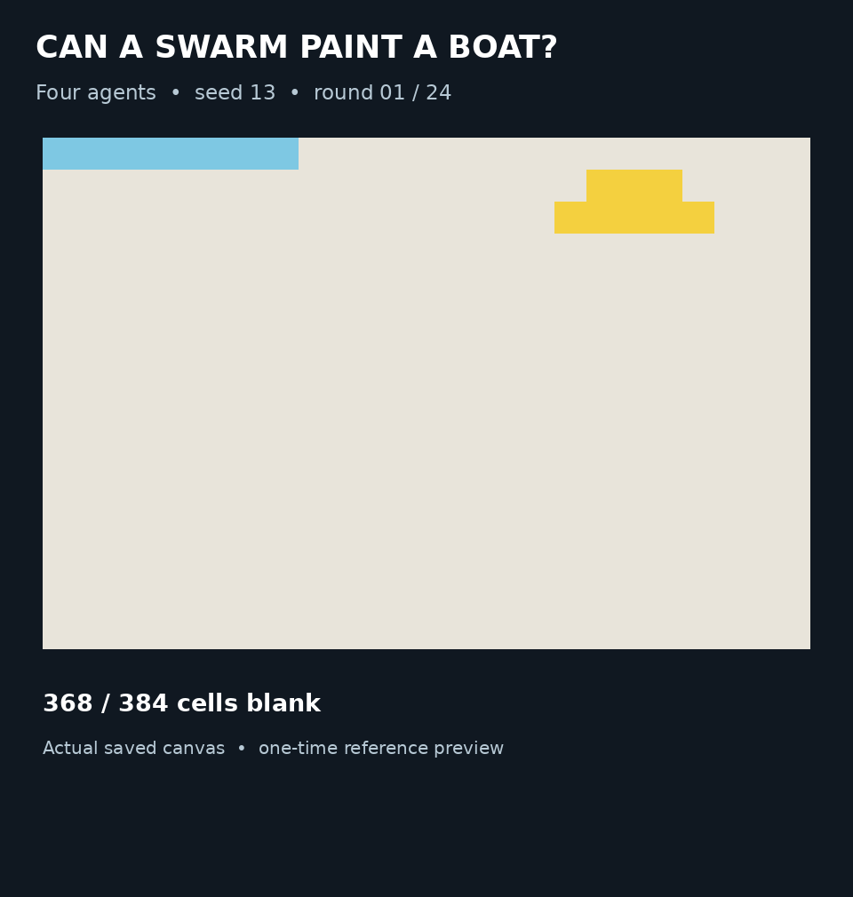
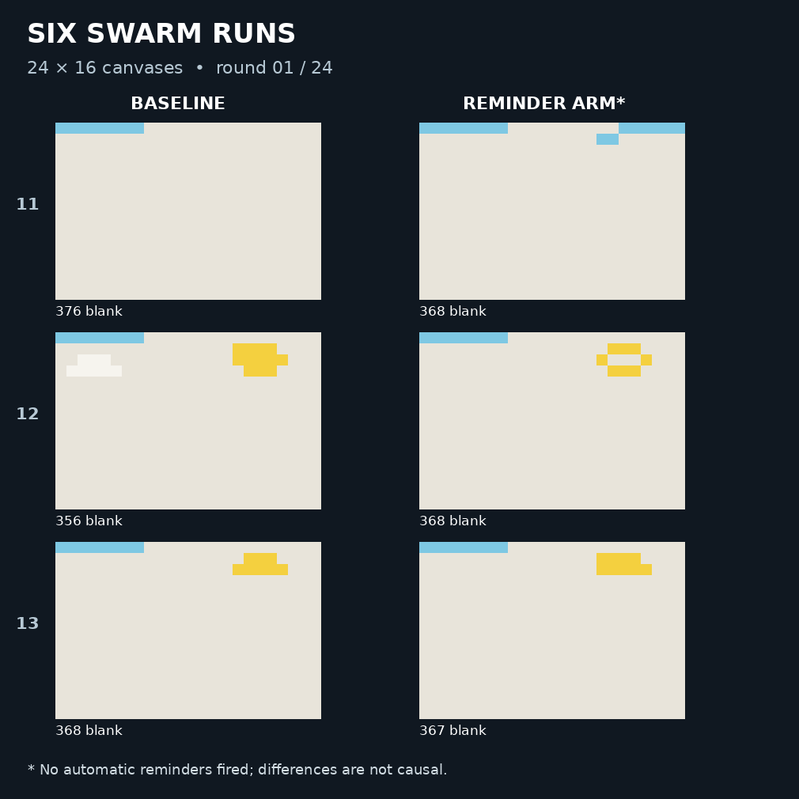

# Swarm Canvas

Can a group of language-model agents coordinate to paint a scene? Swarm Canvas is a research harness for watching agents communicate through **SwarmChat** and paint a shared pixel canvas. The long-term goal is to study coordination from a plain-text goal, then scale the number and mix of agents and the size of the canvas.

In this exploratory run, an agent wrote “All 384 cells complete” in round 12, even though the canvas it saw at the start of that round still had 220 blank cells. This is one observed message, not a rate across runs. [See the six-run replay and results](docs/evidence/paired-study/README.md).

## Latest experiment

Six completed runs used four agents powered by `deepseek/deepseek-v4.1-flash-1017`, a 24 × 16 canvas, and 24 rounds. Each agent received a one-time reference preview and could retain notes; this was an assisted reconstruction experiment, not an unassisted plain-text test. Each pair used a baseline and a reminder-enabled condition, across seeds 11–13.

**The automatic reminder never fired in any reminder-enabled run.** The results show variation between runs but cannot establish an effect of reminders. One earlier seed-13 attempt was interrupted and replaced; it is retained in the evidence. We did not run the proposed 39-run study.

Across these six runs, 2,734 of 4,558 applied paints (60.0%) repeated the cell color at application time, including repeats within a round. In one final round, all four agents reported the grid appeared or should be complete while the shared view still had 251 blank cells; all 32 proposed paints matched their cells at the start of the round. [Inspect the case and data](docs/evidence/paired-study/README.md).

The replays are rendered from saved end-of-round canvases. Blank is beige. Canvas pixels are enlarged without smoothing; the caption about the round-12 claim uses the end-of-round-11 snapshot the agent received.

[Results, methods, and evidence](docs/evidence/paired-study/README.md) · [Earlier findings](docs/findings.md) · [Research roadmap](docs/research-roadmap.md)

## How the harness works

Agents see a shared start-of-round snapshot and submit actions simultaneously. Actions resolve in a seeded shuffled order; later paint wins. Agents have permanent slot IDs, display names, and scratchpads. Reference images are text grids of color codes, not vision inputs. Assistance such as previews, territories, and feedback can be switched on or off.

The harness has not demonstrated reliable autonomous completion. Background-heavy pixel agreement can overstate success; the results also report matches on the target’s non-background cells. Native SwarmChat is required for swarm experiments. Development defaults to free OpenRouter models; the latest experiment used the explicitly authorized paid model.

## Quick start

    python -m pip install -r requirements.txt
    python -m pytest -q
    python cli.py run configs/c1_nochat.yaml --seed 1
    python cli.py swarmchat-check

The random-agent run makes no model calls. The transport check uses the actual local SwarmChat server with scripted agents.

For a capped live boat check, set OPENROUTER_API_KEY in the process environment:

    python -m swarm_canvas.open_boat_check --seeds 11 --rounds 4

Preflight checks the pinned model, zero pricing, and free-request quota. The shared ledger counts repairs, retries, and schema fallbacks. The model seam rejects paid IDs and other providers, sets zero price ceilings, and disables provider fallback. Free-model availability can change.

Historical C0/C1/C2a/C2b configurations compare one painter, multiple painters without messages, a document log, and SwarmChat. Their reconstruction tasks show a reference each turn; they differ from the open-ended boat task. Shipped configs include random and live agents: inspect agents.type before running.

## Experimental switches

Independent assistance switches: reference_image, assigned_territories, suggested_paints, require_messages, and require_peer_acks. Interface switches: color_legend and action_results. Open-ended defaults keep them off. Repeated paints are allowed.

These exploratory modules make live calls and require sufficient free quota:

    python -m experiments.reference_visibility_probe
    python -m experiments.duration_probe
    python -m experiments.retained_notes_probe
    python -m experiments.voluntary_peek_probe
    python -m experiments.free_peek_probe

The free-look module now specifies 24 rounds for the pending comparison. The earlier six-round script is preserved in its evidence archive.

The three-seed matched look comparison is prepared, not completed:

    python -m experiments.matched_peek_comparison
    python -m experiments.matched_peek_comparison --resume runs/<comparison>.json

The interleaved schedule checks quota before each condition and retains completed and failed attempts. It is not a background scheduler. Interrupted active attempts require inspection. Free looks preserve the painting turn but use another model call.

## Traces, accounting, and recovery

Run directories retain manifests, canvas frames, events.jsonl, rendered prompts, and traces.jsonl. Probes also retain preview traces and optional estimates/look choices. Missing estimates and malformed actions remain part of the record.

SWARM_CANVAS_TRACING=local keeps tracing local. The default auto mode uses the Langfuse SDK with complete credentials, otherwise OpenRouter Broadcast context plus local spans. Destination delivery must be verified separately; these probes do not establish Langfuse ingestion. See [tracing setup](docs/harness-guide.md#tracing-and-langfuse).

The durable SQLite ledger reserves attempts before transport; unknown outcomes remain consumed:

    python -m swarm_canvas.request_budget runs/<batch>/budget.sqlite3

Recovery supports only verified completed-round boundaries with the original config, source, Python version, native local channel, and event log. LLM recovery also requires the original ledger identity and checkpoint attempt count. Partial rounds, later requests, remote channels, and custom probe agents are unsupported. See [recovery scope](docs/roadmap/open-boat.md).

Never commit credentials. Exclude native swarmchat databases and recovery tokens from shared archives. Traces can contain prompts and messages; credential masking is not a general privacy guarantee.

## Next steps

The immediate priority is to publish the exploratory results with their limits and close out this study. Future work can improve completion detection, evaluate scene quality beyond background pixels, test less assistance, and scale the swarm and canvas with controlled budgets.

The [harness guide](docs/harness-guide.md) has detailed commands, condition definitions, tracing configuration, and historical pilot instructions. The [research roadmap](docs/research-roadmap.md) describes follow-on work.
