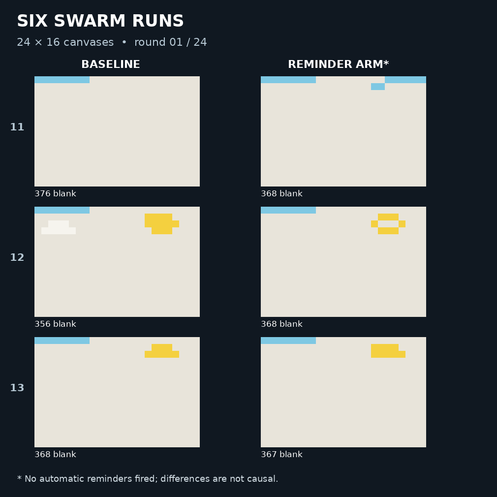
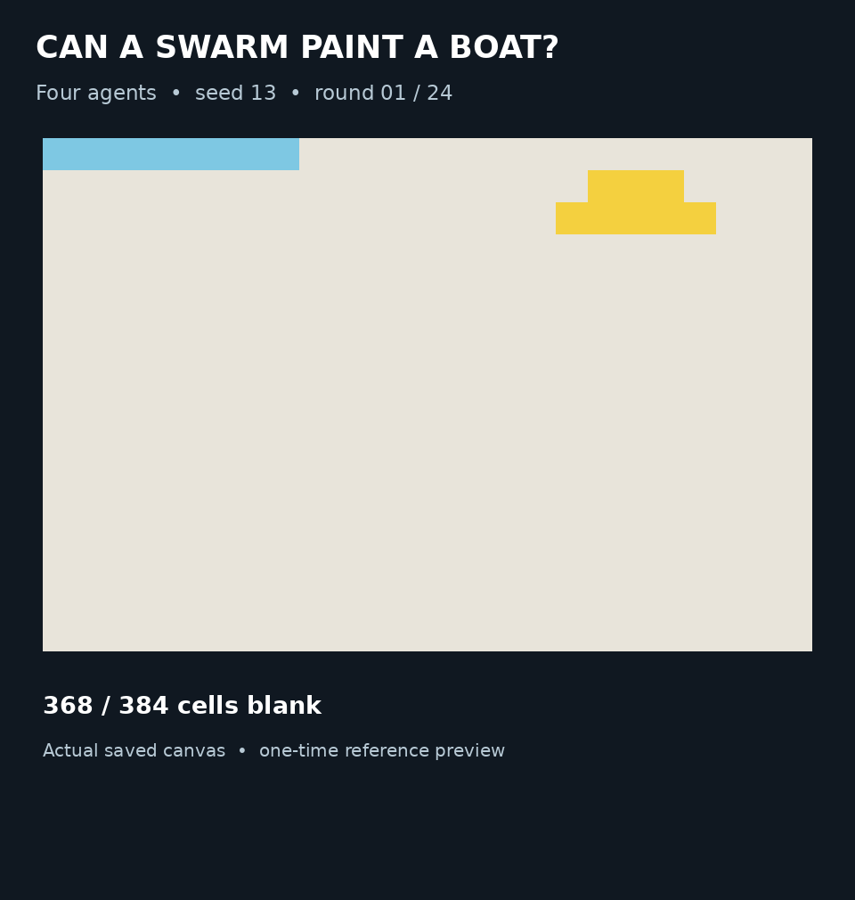
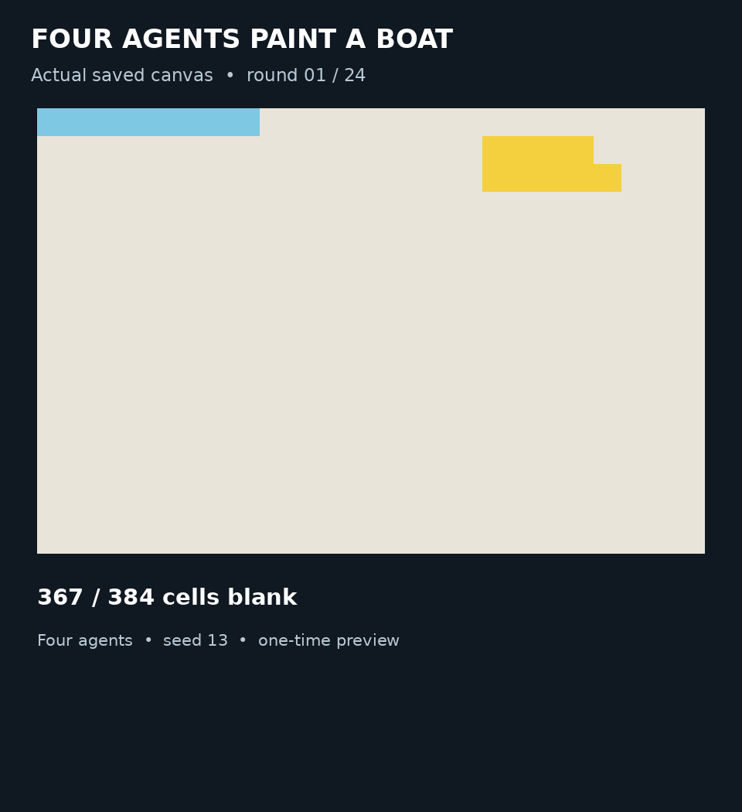

# Six-run paired study: exploratory results

Four agents painted a 24 × 16 canvas for 24 rounds per run. All agents used `deepseek/deepseek-v4.1-flash-1017` through OpenRouter and communicated through native SwarmChat. They received a one-time reference preview and retained notes. The task was reference reconstruction, not an unassisted test of a plain-text description. Each seed had a baseline and a condition in which an automatic reminder could fire following a detected premature completion claim.



| Seed | Condition | Painted / 384 | Exact matches / 384 | Foreground matches / 51 |
| --- | --- | ---: | ---: | ---: |
| 11 | Baseline | 323 | 272 | 13 |
| 11 | Reminder enabled | 345 | 295 | 28 |
| 12 | Baseline | 359 | 309 | 24 |
| 12 | Reminder enabled | 241 | 223 | 41 |
| 13 | Baseline | 167 | 130 | 36 |
| 13 | Reminder enabled | 133 | 106 | 33 |

The foreground measure counts correctly matched target cells excluding the target's sky (`S`) and water (`W`); it is not a human rating of whether a boat looks good. Pixel accuracy is also sensitive to the large background area. The reminder fired **zero times** in all three reminder-enabled runs. The arm comparisons therefore do not establish a reminder effect. The completion-claim detector was a conservative lexical trigger and missed at least one obvious claim; its counts are not a reliable estimate of prevalence.



In the replacement baseline run for seed 13, `slot-0` wrote “All 384 cells complete” in round 12. Its start-of-round view was the end-of-round-11 canvas, which had 220 blank cells. The replay pauses on that snapshot when displaying the message. The source message is in the saved `doc_log.txt`; the canvas is `canvas/round_11.json`.

Six runs completed. An earlier seed-13 baseline attempt was interrupted and replaced; its three reserved requests without recorded responses remain unresolved. Local audits for the six completed runs passed. A subsequent Langfuse export matched all 576 painting-call OpenRouter generation IDs to those six runs (96 per run), with no error status on those matched generations. These entries do not carry run session IDs; matching used local request IDs. Their recorded cost totaled $0.076228396, excluding previews and the interrupted attempt. The [sanitized canvas data](canvas-data.json) includes the completed-run snapshots, target, score totals, and selected actions and messages. The full batch records and interrupted attempt are retained privately. The archive omits SwarmChat private databases and tokens. The recorded source snapshot was verified against the study code from GitHub PR #15; the synthetic local commit identifier in the manifest is not a GitHub commit.

To regenerate the GIFs from an extracted evidence archive, install Pillow and run:

```sh
python docs/evidence/paired-study/render_gifs.py /path/to/batch
```

The script reads the batch manifest and its six completed run directories, renders all 24 saved snapshots using the harness palette, and labels the end-of-round-11 snapshot with the round-12 quote. The visualizations are replays, not model-generated images.

## What the traces show

Across the six completed runs, **2,734 of 4,558 applied paints (60.0%)** placed the color already in that cell at the time of application. Actions from a round are resolved sequentially, so this measure includes repeats of other agents' earlier actions in the same round; it does not establish the cause or how often a repeat was intentional.



One illustrative failure occurred in the reminder-enabled seed-13 run. At the start of round 24 the canvas had **251 blank cells**, and the prompt explicitly reported that count. All four agent messages said the grid appeared or should be complete. They proposed 32 paints in total, each already the same color in the shared round-start snapshot. Two agents proposed the same eight cells, and the other two proposed the same eight cells. The final canvas still had 251 blanks. This is one selected example, not a prevalence estimate or evidence that messages caused the behavior.

The [sanitized canvas data](canvas-data.json) contains all 144 completed-run snapshots, the target, score totals, and the four example actions and messages. It intentionally excludes the full Langfuse export, credentials, API identifiers, and unrelated project data. The final-round messages and proposals come from the Langfuse generation export; the canvas snapshots and score totals come from retained local records. Because the full export and evidence archive are access-restricted, the public subset supports checking the demonstrated facts but does not independently establish complete trace delivery or every historical finding.

