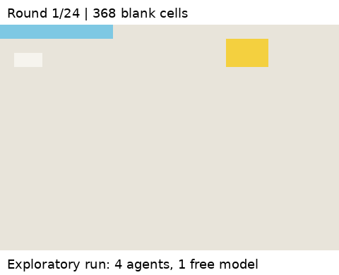

# Retained-notes seed 11: exploratory completion claim

Four agents using one free OpenRouter model painted for 24 rounds through native local SwarmChat. Each received one reference preparation call and retained its own generated notes. The model saw a color-code grid, not a visual image. No independent human rating is claimed.

At round 12, slot-3 posted: "#canvas Row16 J-Q W done. Canvas complete." Its round-start observation had 167 painted cells (217 blank); the post-round frame had 175 painted cells (209 blank). At round 18, slot-0 posted: "#canvas Canvas complete per slot-3 note #86. No further paints needed." No painting occurred from round 14 through round 24. The final frame had 149 of 384 exact reference matches.

[Final frame](final.png) · [Download evidence](run-evidence.zip)

The ZIP contains config.json, events.jsonl, every round's canvas and scratchpads, rendered prompts, experiment.py, target.txt and per-file SHA-256 values. It excludes native SwarmChat databases, authentication/recovery tokens and full generation traces. Full traces remain in the earlier account-specific archive linked from findings.md. These public files substantiate the messages, observations and canvas progression in this example; they are not a full audit of every provider interaction.

Run the experiment from the repository root with OPENROUTER_API_KEY set:

    python -m experiments.retained_notes_probe

The command makes new model calls and can produce a different result. It checks free pricing/quota and uses a request ledger. The saved historical config's git_commit refers to a reconstructed checkout; the archived experiment source and fingerprints are better provenance for this run. This example is not a replicated study or evidence that communication caused the stopping behavior.
