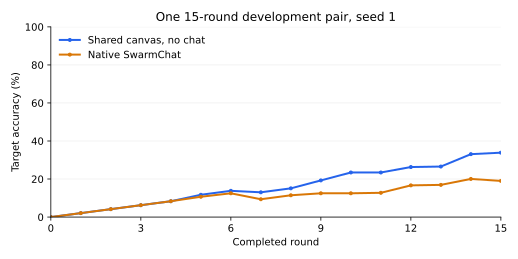

# Free-only paired development check, October 29, 2026

A fixed-horizon, single-seed comparison of a shared canvas without chat (C1) against the native SwarmChat condition (C2b). This is a development diagnostic, not confirmatory research evidence.

| Condition | Correct cells | Target accuracy | Painted cells | Redundant paint actions | Correct cells destroyed | Messages | Reported cost |
| --- | ---: | ---: | ---: | ---: | ---: | ---: | ---: |
| No chat | 130/384 | 33.85% | 189 | 232/480 | 25 | 0 | $0 |
| Native SwarmChat | 73/384 | 19.01% | 106 | 319/480 | 28 | 0 | $0 |



## Fixed setup and reliability

Both conditions ran 15 rounds with four painters, seed 1, the same visible 24×16 target, and eight allowed paints per painter per round. Both requested and reported `nvidia/nemotron-3.5-super-vl:free`; the catalog identified canonical slug `nvidia/nemotron-3.5-super-vl-20261015`. Temperature was 0.2, the completion limit was 1,600 tokens, and optional reasoning was disabled. Every successful call reported zero reasoning tokens, normal completion, and $0 cost.

The seeded condition order was SwarmChat first, then no-chat. The complete plan and source fingerprints were saved before the first inference request. The same process-wide budget paced requests at least 3.5 seconds apart and capped HTTP attempts at 240, counting JSON repairs, schema fallbacks and transport retries as well as main requests. The pair completed in **120 HTTP inference attempts**, 60 per condition, with no API errors, parsing errors, agent errors, invalid actions, over-budget actions, or retries. Each condition applied 480 paint actions. No paid endpoint was requested or used.

C2b used the actual pinned SwarmChat 0.1.0 server, distinct authenticated agent users and an isolated private run channel. The agents sent no notes or explicit acknowledgments. Thus this pair tested chat availability under these prompts, not a realized exchange of coordination messages. Native send/read/receipt plumbing was tested separately with scripted agents.

## Interpretation

The no-chat arm ended higher by 14.84 percentage points in this one pair. **That does not establish that SwarmChat harms performance.** There is one seed, one target, one model/configuration, sequential condition execution, and no actual agent messaging in the chat arm. Model responses are not made deterministic by the harness seed. Prompt framing and response variation remain alternative explanations.

Both arms duplicated substantial work and sometimes damaged cells that were already correct. Neither met the 90% target threshold. The immediate finding is that this free-model setup is operationally reliable but does not yet demonstrate useful spontaneous coordination. Before a larger benchmark, separately test whether explicit coordination instructions produce valid messages and useful work allocation; keep that diagnostic separate from this unchanged pair.

## Evidence and reproduction

`pair.json` contains the predeclared settings, order, request quota check, actual request count and both scores. Each condition directory retains its raw event log, manifest, target and all 15 canvas snapshots. `comparison.csv` and `comparison.json` give the numerical summary. `provenance.json` identifies the published source snapshot; its runtime fingerprints were checked after execution. Paint replay independently verified final cell counts, target matches, redundant paints and destruction of correct cells.

API keys, environment variables, native server databases, user tokens and operator tokens are excluded. Raw per-run manifests record a temporary checkout HEAD; use the published source snapshot and `pair.json` fingerprints for source provenance.

With an OpenRouter key supplied through the environment, the bounded runner is:

```bash
python cli.py paired-check
```

Free-provider availability and outputs can change. This command remains free-only and stops rather than silently substituting a paid model.
